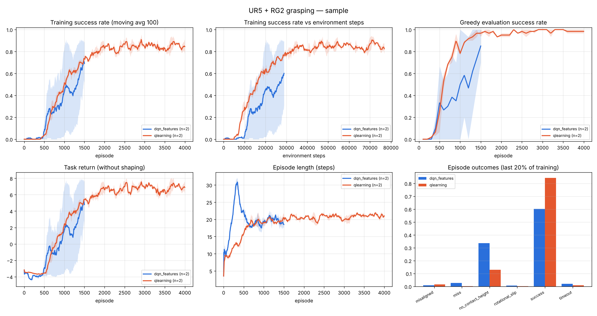

# Results: sample

| group | seeds | episodes | env steps | final eval success | best eval success | episodes to 80% | train success (last 100) | wall time [s] | parameters |
|---|---|---|---|---|---|---|---|---|---|
| dqn_features | 2 | 1500 | 29,916 | 0.85 ± 0.15 | 0.85 | 1000, — | 0.69 | 140 | 36,105 |
| qlearning | 2 | 4000 | 77,177 | 0.98 ± 0.02 | 1.00 | 800, 900 | 0.84 | 216 | 18,531 |

- **dqn_features** (seed 0): {'buffer': 28873, 'updates': 13937}
- **qlearning** (seed 0): {'states_visited': 1630, 'table_size': 18531, 'sa_visited': 7233}
